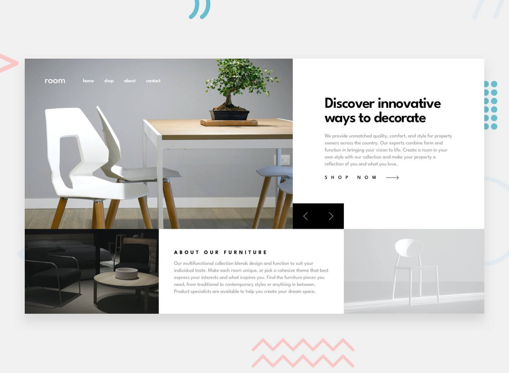

# Frontend Mentor - Room homepage solution

A solution to the [Room homepage challenge on Frontend Mentor](https://www.frontendmentor.io/challenges/room-homepage-BtdBY_ENq).

## Overview

### The challenge

Users should be able to:

- View the optimal layout for the site depending on their device's screen size
- See hover states for all interactive elements on the page
- Navigate the slider using either their mouse/trackpad or keyboard

### Screenshot

### Links

- Solution URL: https://github.com/OTAKU-ACE-coder/room-homepage-master
- Live Site URL: https://otaku-ace-coder.github.io/room-homepage-master/

## My process

### Built with

- Semantic HTML5 (`header`, `nav`, `main`, `section`, `picture`)
- CSS custom properties, Flexbox and CSS Grid
- Mobile-first workflow with a single desktop breakpoint
- Vanilla JavaScript (no libraries)
- Google Fonts: League Spartan

### What I learned

- Swapping art-directed images with `<picture>` and updating both `srcset` and `src` from JS.
- Making a carousel accessible: labelled buttons, `aria-live` text, keyboard arrows.
- Building a mobile menu with `aria-expanded`, Escape-to-close and a backdrop.

### Continued development

- Add touch swipe support to the slider.
- Add a screenshot of the finished page.

## Run it

Open `index.html` in a browser. No build step is needed. An internet connection is needed for the Google Font; otherwise a fallback font is used.

## Author

- GitHub - [OTAKU-ACE-coder](https://github.com/OTAKU-ACE-coder)
